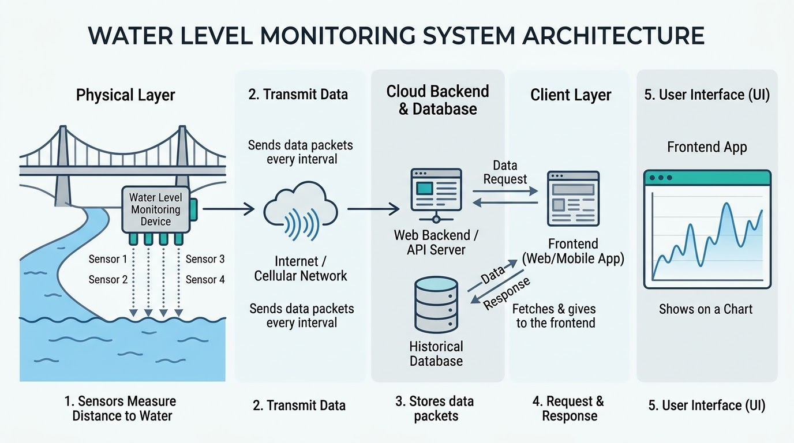

## SURGE - Real-Time Flood Warning System 🌊


An end-to-end IoT and Web solution engineered to bridge remote river level monitoring sensors directly to an interactive, real-time web dashboard.

The system continuously measures water clearance height at river locations using arrayed ultrasonic sensors, transmits telemetry payloads over Wi-Fi, stores historical time-series data, and visualizes real-time threat levels with interactive geographic maps and graphs.

## System Overview



## Usage

- Clone the repo:

```bash
git clone https://github.com/ZentrixMora/SURGE-Simulators.git
```

- Then double click any of the `.bat` file to run it.

---

## References

- [Web Backend](https://github.com/WimansaHansanee/SURGE-WebBackend)

- [Web Frontend](https://github.com/WimansaHansanee/SURGE-WebFrontend)

- [Arduino Code and Hardware Wiring](https://github.com/ZentrixMora/SURGE-Arduino)